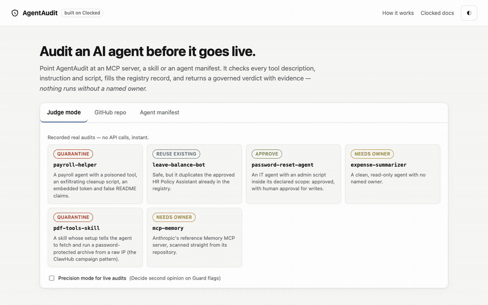
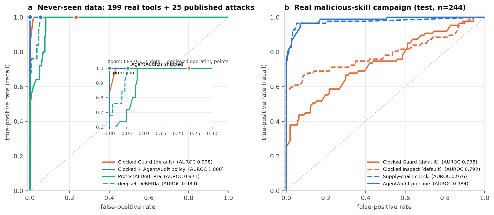

<h1 align="center">AgentAudit</h1>

<p align="center">
  <b>Audit an AI agent before it goes live.</b><br>
  Point it at an MCP server, an agent skill or an agent manifest. It returns a governed verdict, a per-tool enable decision and evidence quoted from the source.<br>
  Built on all nine <a href="https://clocked.rezolve.ai">Clocked</a> endpoints, and evaluated on held-out benchmarks with confidence intervals.
</p>

<p align="center">
  <a href="https://github.com/Himanshu-Sangshetti/agentaudit/actions/workflows/ci.yml"></a>
  <a href="LICENSE"></a>
  
</p>

<p align="center">
  <a href="docs/media/demo.mp4"></a>
  <br><sub>Judge mode replays recorded real audits, so no key and no credits are needed. <a href="docs/media/demo.mp4">MP4</a> · <a href="https://himanshu-sangshetti.github.io/agentaudit/site/">Interactive write-up</a> · <a href="docs/REPORT.md">Technical report</a></sub>
</p>

## Findings

1. **Malicious skills are caught by a check we added, not by any single endpoint.** On a real February 2026 malware campaign (n=244, held out), the best single Clocked endpoint catches **48.3%**. AgentAudit's supply-chain check (Extract pulls every download-and-run instruction, Decide judges the source) raises that to **80.5% at 3.2% false alarms**. Balanced accuracy goes from 72.9 to 88.6 (Holm p = 7.4×10⁻⁶).
2. **Guard ranks agent text well, but its shipped operating point flags 1 in 4 benign tools.** On 199 real MCP tool descriptions plus 25 published attacks, Guard's AUROC is already 0.998, yet the default verdict flags **23.2%** of benign tools. Agent-specific context brings that to **5.4%** with every attack still caught, and `--precision` brings it to **0%**.
3. **Most of the tool-poisoning gain is configuration, and we say so.** On the MCPTox held-out test (n=253), balanced accuracy goes from 84.9 to 97.6 and false alarms from 25.9% to 2.2%. Agent-specific `instructions` do most of it (→ 95.7) and a consensus rule the rest. Re-tuning the default threshold doesn't help (83.8).
4. **The harness is faithful to Clocked's own.** It reproduces Clocked's published jev-benchmark result exactly: **507/868**. Guard returned identical outputs on 30/30 uncached re-runs.

<p align="center"></p>

## Quickstart

```bash
uv tool install git+https://github.com/Himanshu-Sangshetti/agentaudit

agentaudit demo                       # replay recorded audits: no key, no network
agentaudit demo payroll-helper        # one full report
agentaudit estimate ./my-mcp-server   # predicted credit cost, no API calls

export CLOCKED_API_KEY=...
agentaudit scan ./my-mcp-server --precision
agentaudit scan https://github.com/org/some-mcp-server     # shallow clone, nothing executed
agentaudit scan agent.yaml --registry ./approved-agents    # also checks duplicates and reuse
agentaudit scan . --format sarif --out agentaudit.sarif    # GitHub code scanning
```

Exit code `1` means a quarantine verdict or a finding at or above `--fail-on` (default `high`), so it works as a CI gate. A typical audit costs 20–90 credits (about 0.4–2 US cents). Every response is cached, so a re-run after a `--budget` stop pays only for what's left.

**Which mode?** Use `--precision` to gate a registry of mostly trusted agents: it removed every false quarantine in our real-world sample. Use the default (higher recall) for untrusted code in CI.

## How it works

<p align="center"></p>

Collection is static: repos are shallow-cloned and read as text, and nothing is executed. Each endpoint has one job, and each one produces something you can see in the report.

| Group | Endpoint | Job | What it puts in the report |
|---|---|---|---|
| Safety | **Guard** | Hidden instructions in tool descriptions, skills, READMEs and admin overrides | Finding AA001 with the injected span highlighted |
| | **Inspect** | Scripts, install hooks and skill code, judged against the declared scope | Finding AA002 with the risky lines |
| | **Protect** | Secrets and personal data, in one batched call | Finding AA003; its spans mask the value everywhere in the report |
| Documents | **Extract + Decide** | Supply-chain check: every "download and run" target, then "is this source untrusted?" | Finding AA005 with the verbatim instruction |
| | **Fill** | The registry record | Purpose, owner, write access, network reach, data sensitivity, blast radius |
| | **Decide** | The verdict, plus the second opinion in `--precision` | `approve`, `needs_owner`, `reuse_existing` or `quarantine`, with probabilities |
| Fact-check | **Verify** | Each README claim ("read-only", "never sends data out") against the extracted capabilities | Finding AA004 listing the false claims |
| | **Compare** | Duplicate or overlapping agents in your registry | Overlap scores per approved agent |
| | **Rerank** | Which approved agent already does this job | The "reuse X instead" suggestion |

Three policy rules sit on top, because *policy, not the model, should set an agent's authority*:
1. **The accountable owner comes from registry metadata** (manifest `owner` or CODEOWNERS). It's never inferred from a README.
2. **Autonomy is computed** from the verdict, write access and risk.
3. **"Reuse X instead" needs Compare and Rerank to agree.**

## Results

Every arm runs on the same rows. Metrics are balanced accuracy (BAcc) and AUROC, with 95% stratified bootstrap CIs and exact McNemar tests with Holm correction, following Clocked's own published method. Splits are disjoint by server, technique or repository. Each configuration was chosen on dev and frozen before its test run. The plan is in [`bench/PROTOCOL.md`](bench/PROTOCOL.md), and the commit history records the order.

| Suite (held out) | Clocked as shipped | Clocked + AgentAudit | Strongest other baseline |
|---|---|---|---|
| **Malicious skills**, real Feb 2026 campaign, n=244 | 72.9 BAcc (best endpoint, 48.3% caught) | **88.6 BAcc · 80.5% caught · 3.2% FPR** | none run on this suite |
| **Real tools + published attacks**, n=249 | 88.4 · 23.2% FPR | **97.3 · 5.4% FPR** (precision: 100 · 0%) | ProtectAI DeBERTa, tuned: 91.7 · 16.5% |
| **Tool poisoning** (MCPTox), n=253 | 84.9 · 25.9% FPR | **97.6 · 2.2% FPR** (Holm p = 1.9×10⁻⁷) | deepset DeBERTa, tuned: 90.8 · 15.8% |
| **Scripts**, n=206 | 84.4 (87.4 with tuned threshold) | 89.9 (vs tuned: p = 0.15, n.s.) | — |
| **Governance verdicts**, 38 agents | 60.5% (one Decide call) | **78.9%** (precision: 89.5%) | — |
| **Real-world audit**, 9 public MCP repos | — | 2/9 false quarantines, **0/9** with `--precision` | — |
| **Harness check**, jev-benchmark, n=868 | 507/868 | — | matches Clocked's published 507/868 |

<p align="center"></p>

**Read the table this way:**
- **Free detectors come close on accuracy but not on false alarms.** A free, locally run DeBERTa with a dev-tuned threshold gets within 6–7 BAcc points on tool poisoning. It flags 15.8% of benign tools, against our 2.2%, and returns no categories, evidence spans or registry record.
- **Scripts:** the gain comes from scope context. When the same command appears in an approved change and in an attack, Inspect alone is at chance (50%). Given the change ticket it reaches 78.6%, or 96.4% with the consensus rule. On ordinary scripts we're level with a tuned threshold.
- **Governance:** removing Guard, Inspect, Protect or Compare makes its own defect type go undetected (0/4, 1/3, 1/3 and 0/9 caught). Extract, Fill, Verify and Rerank don't change verdicts here. They produce the registry record, the claim checks and the reuse suggestion. The cells hold only 3–9 agents.
- **Precision mode is a trade-off.** It removes every false alarm on real tools, but on the templated MCPTox test, recall falls to 74.6%.
- **Real-world audit:** we found no confirmed issues in the 9 public repos. This tests false alarms, not detection. Results are reported in aggregate only.

**For context, from published work on a different dataset:** on MaliciousSkillBench, SkillScreen reports TypeSafe's Jev 1.13 catching 33.8% of malicious skills and GPT-5.5 (zero-shot) catching 72.1% [[6]](#references). Those numbers aren't comparable row for row with ours. We didn't run Jev or a frontier LLM on our suites.

More figures (calibration, threshold sweeps, per-source false alarms, the ablation waterfall, the governance heatmap and latency) are in the [interactive write-up](https://himanshu-sangshetti.github.io/agentaudit/site/) and [`docs/figures/`](docs/figures). Every table, with its CIs, is in [`bench/RESULTS.md`](bench/RESULTS.md).

## Agent platforms

AgentAudit fits platforms that describe an agent as **a role plus connected MCP servers whose tools an admin enables one by one**. That's the model Rezolve.ai's Agentic Studio describes publicly. We haven't tested it inside Studio, which has no public sandbox. It's the gate such a platform would call before publishing an agent.

```yaml
name: it-support-agent
owner: IT Service Desk (itsd@example-corp.com)
role: Resolves employee IT tickets using Jira and GitHub.
mcp_servers:
  - name: atlassian
    url: https://mcp.example-corp.internal/atlassian
    tools:
      - name: create_customer_request
        enabled: false                  # tools start disabled
        description_override: ...       # what the model actually reads is what gets audited
```

Each tool gets **enable**, **review** (it can write or act externally) or **keep disabled** (with the finding that blocked it). Anything not approved for autonomous use produces an escalation item for a human approval queue. See [`examples/studio/it-support-agent.yaml`](examples/studio/it-support-agent.yaml).

```python
from agentaudit.audit import Auditor, capability_facts
from agentaudit.clocked import Clocked
from agentaudit.collect import collect_manifest

registry = [(a.name, capability_facts(a)) for a in approved_agents]
with Clocked(tag="publish-gate", budget=100) as c:
    report = Auditor(c, precision=True).run(collect_manifest("agent.yaml"), registry)

report.verdict["verdict"]["choice"]   # approve | needs_owner | reuse_existing | quarantine
report.tools                          # [{tool, recommendation: enable | review | keep_disabled, why}]
report.escalation                     # item for a human-approval board, or {}
```

The REST hook and web app: `uv run --extra web uvicorn agentaudit.server:app`, then `POST /api/audit`. Each request is capped at 60 credits, with a daily cap and a per-IP rate limit.

**GitHub Action:** findings go to code scanning (SARIF) and the job summary, and the PR fails on a quarantine verdict.

```yaml
on: [pull_request]
permissions: { contents: read, security-events: write }
jobs:
  audit:
    runs-on: ubuntu-latest
    steps:
      - uses: actions/checkout@v4
      - uses: Himanshu-Sangshetti/agentaudit/action@main
        with:
          clocked-api-key: ${{ secrets.CLOCKED_API_KEY }}
```

## Limitations and deviations from the protocol

**Limitations**
- **Source confound.** MCPTox attacks are templated and come from a different source than most benign tools, so part of the tool-poisoning gain may be source separation. The real-tools suite (finding 2) is the check on this. It has only 25 attacks (25/25 caught, Wilson 95% lower bound 86.7%).
- **Authored rows.** We wrote the 40 hard negatives and the 20 scope pairs ourselves. [`bench/RESULTS.md`](bench/RESULTS.md) reports results without them.
- **Labels.** Atomic Red Team includes dual-use commands. Governance labels come from a construction recipe over synthetic manifests built from real tools.
- **No other decision model** was run on our suites. Jev appears only through jev-benchmark's published answers.
- **Static collection** misses tools that are registered at runtime. Use live `tools/list` collection for those.

**Deviations from the pre-registered protocol**
- **Leave-one-template-out runs:** planned, not run.
- **Adaptive attacks:** planned, not run. We used only published attack sets.
- **Skills split:** random, not cluster-disjoint, with no near-duplicate analysis.
- **Governance owner rule:** changed after the first full run, from inferred to registry-declared. This is disclosed in the protocol; v1 scored 65.8.
- **Protect `internal_url` category:** narrowed after the real-world study.

## Reproduce

```bash
uv sync --all-extras --all-groups
uv run python bench/report.py     # every table, from the cached per-row records (0 credits)
uv run python bench/figures.py    # every figure (0 credits)
uv run pytest -q                  # 35 offline tests
```

The raw runs (`bench/suites/run_*.py`) spend credits. Each one has a budget, and every paid call is logged in `bench/credit_ledger.jsonl`.

<details>
<summary><b>Project layout, security and data handling</b></summary>

```
src/agentaudit/   clocked.py (client: cache, retries, budgets, ledger) · collect.py (repos, skills, manifests, live MCP)
                  audit.py (nine-endpoint audit, policy, supply-chain check, precision) · render.py (MD/JSON/SARIF)
                  cli.py · server.py (REST hook + web app with judge mode)
bench/            PROTOCOL.md · RESULTS.md · REALWORLD.md · suites/ · baselines/ · results/ (per-row records)
docs/             REPORT.md · figures/ · assets/ · media/ · site/ (interactive write-up)
web/ action/ examples/ tests/
```

- **What goes to Clocked:** only the text of an agent's artifacts and short summaries built from them, over HTTPS. See [Clocked's security page](https://clocked.rezolve.ai/docs/security).
- **Nothing is executed.** Scripts and hooks are sent to Inspect as data. The one opt-in exception is `collect_live`, which starts an MCP server command you supply in order to read its `tools/list`.
- **Keys stay server-side,** from the environment or a git-ignored `.env`. The web app never sends the key to the browser.
- **Redaction:** every value Protect finds is masked in the evidence, the registry record, and the Markdown, JSON and SARIF output.
- **Local state:** `.cache/clocked/` and the ledger hold the text sent and the results. Delete `.cache/` to remove them.

</details>

## References

1. Invariant Labs (2025). *MCP Security Notification: Tool Poisoning Attacks.* [invariantlabs.ai](https://invariantlabs.ai/blog/mcp-security-notification-tool-poisoning-attacks)
2. Wang et al. (2025). *MCPTox: A Benchmark for Tool Poisoning Attack on Real-World MCP Servers.* [arXiv:2508.14925](https://arxiv.org/abs/2508.14925)
3. Liu et al. (2026). *When the Manual Lies: A Realistic Benchmark to Evaluate MCP Poisoning Attacks for LLM Agents* (MCP-TDP; finds prompt guardrails largely ineffective). [arXiv:2605.24069](https://arxiv.org/abs/2605.24069)
4. Liu et al. (2026). *ShareLock: A Stealthy Multi-Tool Threshold Poisoning Attack Against MCP.* [arXiv:2606.27027](https://arxiv.org/abs/2606.27027)
5. Wang et al. (2026). *MaliciousSkillBench: A Comprehensive Benchmark for Malicious Agent Skill Detection.* [arXiv:2608.19901](https://arxiv.org/abs/2608.19901)
6. Huang et al. (2026). *SkillScreen: High-Recall Screening of Malicious Agent Skills with Decision Models.* [arXiv:2610.17727](https://arxiv.org/abs/2610.17727)
7. Hou & Yang (2026). *SkillSieve: A Hierarchical Triage Framework for Detecting Malicious AI Agent Skills.* [arXiv:2604.06550](https://arxiv.org/abs/2604.06550)
8. Yang et al. (2025). *MCPSecBench: A Systematic Security Benchmark and Playground for Testing Model Context Protocols.* [arXiv:2508.13220](https://arxiv.org/abs/2508.13220)
9. Li & Liu (2024). *InjecGuard (PIGuard): Benchmarking and Mitigating Over-defense in Prompt Injection Guardrail Models.* [arXiv:2410.22770](https://arxiv.org/abs/2410.22770)
10. Clocked. *Benchmarks* (jev-benchmark, grounding and PII results). [clocked.rezolve.ai/benchmarks](https://clocked.rezolve.ai/benchmarks)

**Data used, under its own terms:**
- [jev-benchmark](https://github.com/ejs-5/jev-benchmark) (MIT)
- [agent-skill-malware](https://huggingface.co/datasets/yoonholee/agent-skill-malware) (MIT)
- MCPTox (no license, so only IDs and predictions are released, no text)
- [InjecAgent](https://github.com/uiuc-kang-lab/InjecAgent) (MIT)
- [Atomic Red Team](https://github.com/redcanaryco/atomic-red-team) (MIT)
- lazywinadmin/PowerShell (MIT)
- mcp-tool-poisoning (Apache-2.0)
- reference and public MCP servers (MIT, Apache or BSD)

**Baselines:**
- [ProtectAI DeBERTa v2](https://huggingface.co/protectai/deberta-v3-base-prompt-injection-v2)
- [deepset DeBERTa](https://huggingface.co/deepset/deberta-v3-base-injection)

## License and citation

Code is [MIT](LICENSE). The benchmark rows we wrote (hard negatives and scope pairs) are CC-BY-4.0. This is independent work for the Clocked Build Challenge, not affiliated with or endorsed by Rezolve.ai.

```bibtex
@misc{agentaudit2026,
  title  = {AgentAudit: Auditing AI Agents Before Deployment with Decision Models},
  author = {Sangshetti, Himanshu},
  year   = {2026},
  url    = {https://github.com/Himanshu-Sangshetti/agentaudit}
}
```
