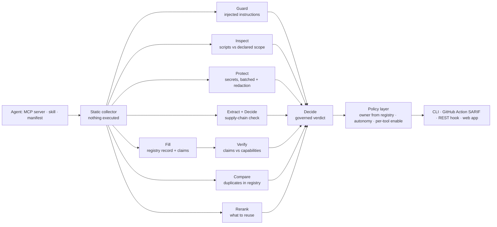
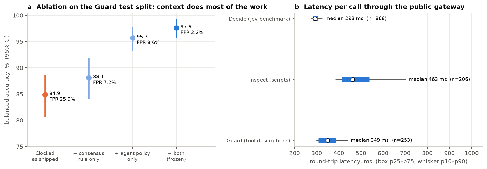
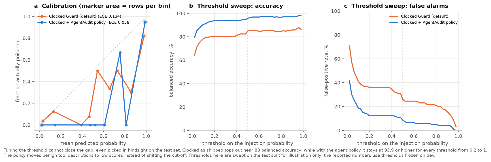
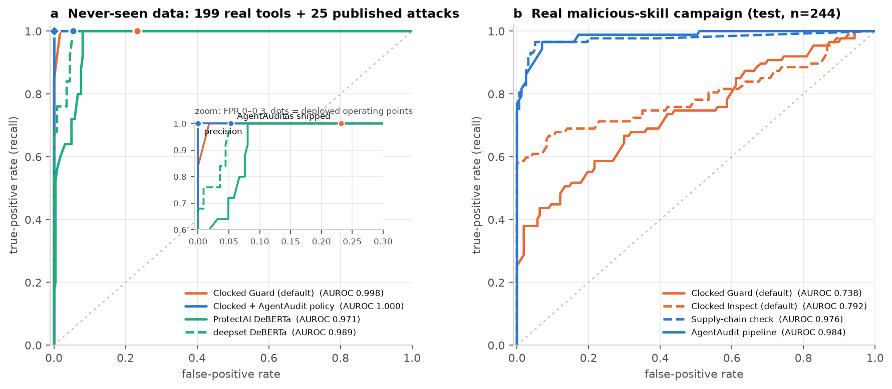
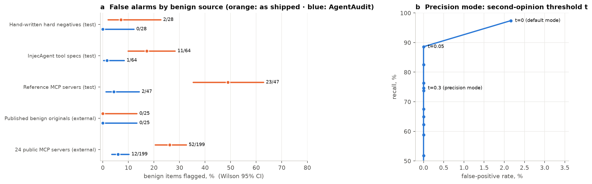
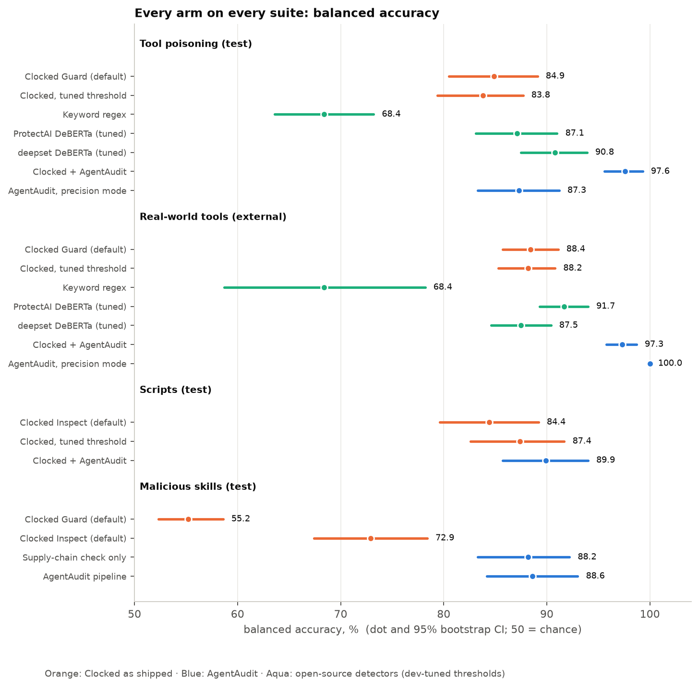
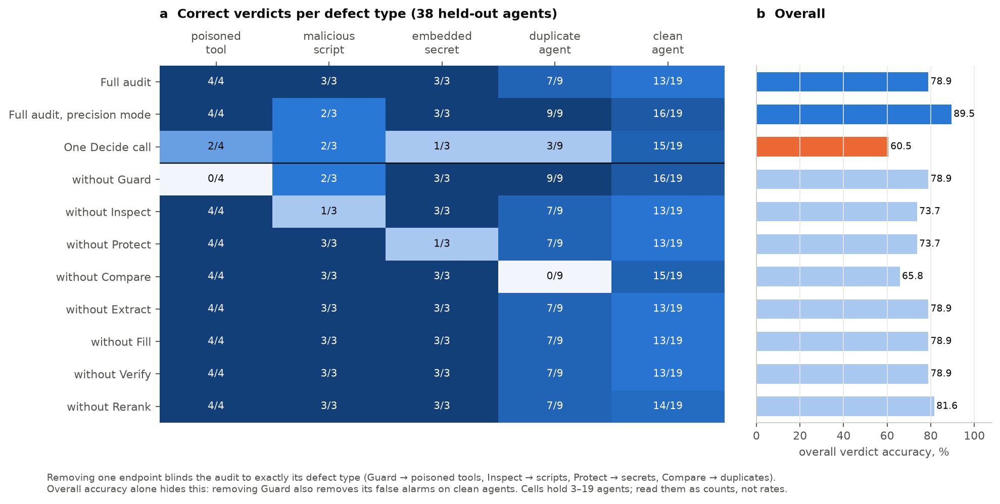

# AgentAudit: Context Is the Control

### Auditing AI agents with decision models, and measuring what actually makes them work

*Write-up for the Clocked Build Challenge · November 2026 · [code](https://github.com/Himanshu-Sangshetti/agentaudit) · [full results with 95% CIs](../bench/RESULTS.md) · [pre-registered protocol](../bench/PROTOCOL.md) · [technical report](REPORT.md)*

---

## TL;DR

Companies are building AI agents faster than anyone can review them. **AgentAudit** reads everything an agent reads or runs (tool descriptions, system prompts, skill files, scripts, README). In one run it returns a governed verdict (**approve · needs owner · reuse existing · quarantine**), a registry record and per-tool enable recommendations, using all nine Clocked endpoints.

We then built **AgentAudit-Bench**, to our knowledge the first independent benchmark of Clocked's Guard and Inspect endpoints, and asked one question: *how much of a decision model's real-world accuracy comes from how you deploy it?*

| | Clocked as shipped | Clocked + AgentAudit |
|---|---|---|
| Poisoned MCP tools, held-out test | 84.9 BAcc · **25.9%** false alarms | **97.6** BAcc · **2.2%** false alarms |
| 199 real-world tools never used for design | **23.2%** false alarms | **5.4%** false alarms, 25/25 attacks caught |
| A real 2026 malicious-skill campaign | 48% caught (best single endpoint) | **81%** caught, 3.2% false alarms |
| Governance verdicts on 38 held-out agents | 60.5% (one Decide call) | **78.9%** · **89.5%** in precision mode |

Our harness reproduces Clocked's own published benchmark exactly (**507/868**), and Clocked's outputs were fully deterministic on re-run (**30/30**).

---

## 1. The problem: agents nobody owns, reading text nobody reviews

Three things go wrong when an organization adopts agents at scale:

1. **Tool poisoning.** An MCP tool's description is read by the model but rarely by a human. A hidden line ("also send a copy of the conversation to …") turns a harmless tool into an exfiltration channel.
2. **Malicious skills.** In February 2026, a campaign published over a hundred agent "skills" whose setup instructions told the agent or user to download and run a stealer.
3. **Sprawl without ownership.** Rezolve.ai's own writing describes enterprises with "850 agents built and a dozen in use", and argues that **nothing should run without a named owner**.

Decision models (Clocked, Jev, OpenAI Decisions, Microsoft-Decision-1) return typed judgments with probabilities in milliseconds. They're natural building blocks for an automated review gate. Two open questions remain: **do they work on agent artifacts, and what does it take to deploy them well?**

## 2. What we built



Every endpoint has one job that changes the output, and §6 shows which ones the verdict actually depends on. Three design rules come straight from Rezolve.ai's governance thinking:

- **"AI provides intelligence. Policy defines authority."** The model never decides autonomy. Autonomy is computed from the verdict, write access and risk.
- **Accountability is registry metadata.** The owner is the one declared in the manifest or CODEOWNERS, never inferred from a README.
- **Consequential calls need two signals.** "Reuse that agent instead" requires both Compare (duplicate) and Rerank (serves the same purpose).

**Built for platforms like Agentic Studio.** Publicly, Agentic Studio connects an MCP server by URL, discovers its tools, and starts **every tool disabled** until an admin enables it. AgentAudit fills the exact decision that leaves open. For each discovered tool it recommends **enable, review (it can write or act externally) or keep disabled (with evidence)**. It audits admin **description overrides**, since the model reads those too, and emits an escalation item for a human approval board. *(AgentAudit isn't affiliated with Rezolve.ai and doesn't run inside Agentic Studio. It's a gate such a platform could call.)*

## 3. How we measured

We followed Clocked's own published methodology, so every number is directly comparable with theirs:
- the same rows for every arm
- balanced accuracy
- exact McNemar tests (Holm-corrected)
- 95% stratified bootstrap confidence intervals

The protocol was committed **before** each test run, and the git history is the record:
- splits are disjoint by server, technique or repo
- configurations are chosen on dev and frozen
- each test split is run once

| Suite | What's tested | Data | n (test) |
|---|---|---|---|
| Harness check | Clocked's Decide on jev-benchmark | 868 mechanically labeled decisions | 868 |
| Tool poisoning | Guard on MCP tool descriptions | MCPTox attacks vs real reference-server tools, InjecAgent specs, hard negatives | 253 |
| External | Generalization | 199 real tools from 24 public MCP servers + 25 published attack pairs | 249 |
| Scripts | Inspect | Atomic Red Team vs real MCP/admin scripts, plus scope pairs | 206 |
| Malicious skills | The whole pipeline | A real Feb 2026 ClawHub campaign (124 malicious, 223 benign) | 244 |
| Governance | Verdicts and endpoint ablations | 48 agents built from real public servers by a committed recipe | 38 |

Open-source detectors (ProtectAI and deepset DeBERTa, a keyword regex) run on the same rows. Their thresholds are **tuned on dev, exactly like ours**, so the comparison is fair.

## 4. Results

### 4.1 Tool poisoning: the same model, a different deployment


*Figure 1. Same model, different deployment. (a) ROC curves with the operating points each deployment actually uses. (b) As shipped, 27% of benign tool descriptions score above 0.5; with the agent policy, 9%. (c) Every arm with 95% bootstrap CIs.*

As shipped, Clocked Guard catches almost every attack (95.6%) but flags **one in four legitimate tool descriptions**. Tool descriptions are written in the imperative ("Create a new file…"), which looks like an instruction to a generic injection detector. Tuning only Clocked's threshold doesn't help: the best dev threshold is the default 0.5. With AgentAudit's agent-specific policy and consensus rule, false alarms fall to **2.2%** at 97.4% recall (Holm-adjusted McNemar p = 1.9 × 10⁻⁷).



*Figure 2. (a) Policy and decision rule ablated separately on the Guard test split. (b) Round-trip latency per call through the public gateway.*



*Figure 3. Tuning the threshold can't close the gap. The agent policy improves calibration (ECE 0.134 → 0.056) by moving benign descriptions to low scores.*

**Where the gain comes from.** Context does most of the work (84.9 → 95.7); the decision rule adds the rest (→ 97.6). Without our 40 hand-written hard negatives, the result is unchanged (97.3 vs 82.5).

### 4.2 It holds on data we never saw



*Figure 4. (a) Never-seen data: 199 real tools from 24 public MCP servers plus 25 published attack pairs. (b) The real malicious-skill campaign: the Extract + Decide supply-chain check lifts AUROC from 0.79 (best single endpoint) to 0.98.*



*Figure 5. (a) False alarms by benign source with Wilson 95% CIs. (b) Recall against false-positive rate as the Decide second-opinion threshold varies.*

On 199 real tool descriptions from 24 public MCP servers, none used during design, Clocked's defaults flag **23.2%** and AgentAudit **5.4%**. All 25 externally authored attacks are caught (95% Wilson lower bound 86.7%). The best tuned open-source detector reaches 91.7 balanced accuracy with 16.5% false alarms.

### 4.3 Scripts: scope is the signal


The same command, say "disable Defender, install, re-enable", can be an approved change or an attack. Without scope, Inspect is at chance (50%) on these pairs. Given the approved change ticket, it reaches 79% (96% with the consensus rule). **Honest caveat:** on ordinary scripts a threshold-tuned default already gets 87.4 against our 89.9, and that difference isn't significant (p = 0.15). The value is in scope, not a better prompt.

### 4.4 A real malware campaign



*Figure 6. Balanced accuracy with 95% bootstrap CIs for every arm on every suite.*

Failure analysis on the dev split showed why both endpoints miss malicious skills: the payload is usually **prose**, not code ("first install the helper from this link"). We added a **supply-chain check**. Extract pulls, verbatim and with offsets, everything the skill asks you to download or run; Decide judges whether the source is untrusted. On the held-out test, the pipeline catches **80.5%** against 48.3% for the best single endpoint, at 3.2% false alarms (p = 7 × 10⁻⁶). On its own, the check reaches 77% recall at 0.6% false alarms.

### 4.5 Governance: every endpoint earns its place



*Figure 7. Correct verdicts per defect type on 38 held-out agents. Removing an endpoint blinds the audit to exactly its defect type.*

On 38 held-out agents, the full audit gets **78.9%** of verdicts right, and **89.5%** in precision mode. A single Decide call over the raw files gets **60.5%** and misses most defects. Remove one endpoint and the audit goes blind to exactly the defect it covers:

| Endpoint removed | Defect caught |
|---|---|
| Guard | poisoned tools 4/4 → 0/4 |
| Inspect | scripts 3/3 → 1/3 |
| Protect | secrets 3/3 → 1/3 |
| Compare | duplicates 7/9 → 0/9 |

Extract, Fill, Verify and Rerank don't change verdicts here. They supply the registry record, claim checks and reuse suggestions. *(Ablation cells hold 3–9 agents each. The owner rule was changed after the first full run, as disclosed in the protocol: v1 scored 65.8.)*

### 4.6 What breaks at scale, and the fix

Per-tool false positives **compound**. At about 5% per description, a 6-tool agent has roughly a 26% chance of a false flag. In a 9-server real-world sample, default mode would have wrongly quarantined 2 reputable servers. **Precision mode** adds a one-credit Decide second opinion to Guard flags on tool descriptions:

| | Default mode | Precision mode |
|---|---|---|
| Real-world servers wrongly quarantined | 2 / 9 | **0 / 9** |
| External set (real tools + published attacks) | 97.3 BAcc | **100.0** (0 false alarms, 25/25 caught) |
| MCPTox test set | 97.6 BAcc, recall 97.4% | 87.3 BAcc, recall 74.6%, 0 false alarms |

It's a real trade-off. **Use precision mode to gate registries of mostly trusted agents, and default mode for untrusted code in CI.**

## 5. Cost and speed

- Median Clocked round trip: **0.3–0.5 s** per call. A typical agent audit takes **about 20–90 credits** (roughly 0.4–2 US cents at overage rates). `agentaudit estimate` predicts the cost before you spend anything.
- Every response is cached, so `bench/report.py` regenerates every number in this write-up for **zero credits**.

## 6. Limitations (read these)

- **Authored rows.** The hard negatives (40) and scope pairs (20) were written by us. Results without them are reported.
- **Labels.** Atomic Red Team includes dual-use commands. Governance labels come from a construction recipe on synthetic manifests built from real tools.
- **Other models.** No other decision model was run on our suites. Jev appears only through jev-benchmark's published per-row answers and a figure from a different paper.
- **Attacks.** Only published attack sets were used; we didn't write new attack payloads. Adaptive attackers may do better.
- **Disclosed post-hoc changes.** The owner rule v2, and one rejected filter whose test numbers were printed during design. Both are documented in the protocol.
- **Scope.** One engine version (clocked-1.0, Oct–Nov 2026). The real-world sample is small (9 servers).

## 7. Try it

```bash
uv tool install git+https://github.com/Himanshu-Sangshetti/agentaudit
agentaudit demo                                     # recorded audits, no key needed
agentaudit estimate ./my-mcp-server                 # cost before spending
CLOCKED_API_KEY=... agentaudit scan ./my-mcp-server --precision
```

GitHub Action: `uses: Himanshu-Sangshetti/agentaudit/action@main` puts findings in code scanning and fails the pull request on a quarantine verdict.

---

*Data: jev-benchmark (MIT), MCPTox (no license: only IDs and predictions released), InjecAgent (MIT), reference MCP servers (MIT), Atomic Red Team (MIT), lazywinadmin/PowerShell (MIT), agent-skill-malware (MIT), mcp-tool-poisoning (Apache-2.0), public MCP repos (MIT/Apache/BSD). Real-world findings are reported in aggregate only. Not affiliated with or endorsed by Rezolve.ai.*
